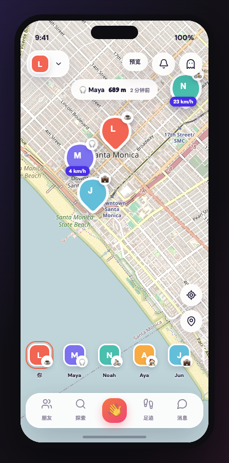

# Pinpop

A Zenly-style social map. Friends show up live, you can wave, chat, and see
who is actually sharing. The same React UI is the website **and** the iOS app
(`com.pinpop.app` via Capacitor). GitHub Pages is only the invite link for
people who do not have the app yet.

<p align="center">
  
</p>

<p align="center">
  <a href="https://william101102.github.io/zenly-app/?preview=1">Open the live preview</a>
  · no account needed
</p>

- **Green ring** — this person is sharing a live location.
- **Gray ring** — they hid it, or have not updated in a while.
- **Zoom out** — overlapping people collapse into a circle with a count. Tap it
  to zoom back in.
- **Highlights** — post a photo (or just a line of text) from the 朋友 tab;
  friends see it in a Zenly/Snap-style story rail for 24 hours, then it's gone.
  Optionally attach your location and it also shows as a circular story pin
  on the map — à la Snap Map — until it expires.
- **Throw something** — tap a friend, pick from 14 throwables (🎂🌹🍕💦…) and
  send it with a little arc animation; landing on someone pops a celebratory
  toast on their end.
- **Streaks** — consecutive days you and a friend interact (message or throw)
  light up an escalating ✨ → 🔥 → 💯 badge, with a ⏳ warning when a streak is
  about to lapse and a small celebration the first time it crosses a milestone.
- **Invite links** — sharing your link mints a token; whoever opens it becomes
  a friend immediately, no separate approval step.

## Feature Overview

Pinpop is a Zenly-style social map app. Friends appear on the map in real time, and you can say hi, chat, and see who's nearby. The same React codebase powers both the web app and the iOS app.

**Map & Location**
- Live location map: Friends' avatars move on the map in real time as they move.
- **Ghost Mode**: Three levels of location privacy: Precise / Blurred (randomly offset by about 0.2–1.2 km) / Frozen (stays at the last shared location). You can set it separately for each friend, and friends never receive your real coordinates.
- Ring color: Green means live location is being shared. Gray means it's hidden or hasn't updated for a long time.
- When you zoom out, overlapping people merge into one circle with a number. Tap it to zoom back in.
- **Nearby check-ins**: Check in at a place (coffee, food, park, gym, shopping, home, work, other) and choose whether friends can see it or only you.
- **Footprints & heatmap**: Tracks the places you visit often and how long you stay. The heatmap is visible only to you. Overnight places (like your home) are detected automatically, and that data stays completely private.

**Social Interaction**
- **Throw items**: Open a friend's profile card, pick one of 14 emoji items (🎂🌹🍕💦…), and throw it with a short animation. The friend gets a celebration popup.
- **Streaks**: The number of consecutive days you and a friend interact (by chatting or throwing items) unlocks level badges: ✨ → 🔥 → 💯. A ⏳ reminder appears when a streak is about to break, and the first time you hit a milestone (3/7/14/30/50/100/200/365 days) there is a small celebration animation.
- **Streak recovery** (same logic as TikTok/Douyin): Missing a day is fine. If you interact for the next 3 days in a row, the streak is restored to the number it had before it broke (plus those 3 days). The profile card shows 🩹 recovery progress.
- **Highlights (stories)**: Post a photo or a line of text on the Friends tab. Friends see it in a Zenly/Snap-style story bar, and it disappears after 24 hours. You can attach your location, which also puts a circular story pin on the map (like Snap Map). It disappears when it expires.
- **Zenlands (my places)**: Give a name to a place you visit often (like your gym). Friends can see the name, and they get a notification when you arrive or leave.
- **Group chat**: Pick at least two friends to create a group chat.
- **One-on-one chat**: Private chat, unread message badges, and a notification center that collects friend requests, unread messages, received emoji items, and friend updates.

**Adding Friends**
- **One-tap invite link**: Share your personal link, and anyone who opens it becomes your friend right away, without the "accept request" step (same logic as Discord/WhatsApp invite links).
- You can also add friends by searching username/nickname, and the traditional send/accept friend request flow is supported too.

**Account & Language**
- Sign up and log in with email, avatar upload (automatically cropped and compressed), and custom status text/emoji.
- Account deletion (with a second confirmation for this dangerous action).
- The whole app interface is now fully in English (it was originally in Chinese), which makes it suitable for overseas users.

## Run it locally

You need **Node 20+** and npm. No Xcode and no Supabase keys for the demo.

```bash
git clone https://github.com/William101102/zenly-app.git
cd zenly-app
npm install
npm run dev
```

Open [http://127.0.0.1:5173/?preview=1](http://127.0.0.1:5173/?preview=1).

On a laptop the page is a phone frame. That is the app, not a marketing site.
`?preview=1` loads demo friends around Santa Monica so you can tap around
without an account.

```text
npm run test        # unit tests
npm run typecheck   # TypeScript
```

### Real accounts (optional)

The preview is enough to see the product. To sign in for real:

1. Copy `.env.example` to `.env.local`.
2. Put in your Supabase URL and anon key (never a service-role key).
3. Run `backend/supabase/setup.sql` in the Supabase SQL editor (again after
   pulling, so the public avatar policy and 0.2–1.2 km blur stay current).
4. Restart `npm run dev` and open [http://127.0.0.1:5173/](http://127.0.0.1:5173/)
   without `?preview=1`.

| Variable | Where |
|---|---|
| `VITE_SUPABASE_URL` | `.env.local` and GitHub Actions vars |
| `VITE_SUPABASE_ANON_KEY` | same |
| `VITE_PUBLIC_APP_URL` | optional; invite links inside the installed app |

## Ship it to the App Store

The store build is this same UI inside a native shell. You cannot skip Xcode or
the Apple Developer Program. Review notes and permission copy live in
[`ios-setup/README.md`](ios-setup/README.md).

### 1. Accounts and tools (one-time)

1. Join the [Apple Developer Program](https://developer.apple.com/programs/) ($99/year).
2. Install **full Xcode** from the Mac App Store (Command Line Tools are not enough).
3. Point the toolchain at it and accept the license:

   ```bash
   sudo xcode-select -s /Applications/Xcode.app/Contents/Developer
   sudo xcodebuild -runFirstLaunch
   ```

4. Install CocoaPods: `brew install cocoapods`.
5. Have a Supabase project with `backend/supabase/setup.sql` applied, and the
   same `VITE_SUPABASE_*` values you use locally.

### 2. Generate the iOS project

From the repo root, with `.env.local` already filled in:

```bash
npm install
npm run ios:add      # once: creates ios/ and writes Info.plist + icons
npm run ios:sync     # after any UI change: rebuild web assets into ios/
npm run ios:open     # opens Xcode
```

`ios/` is generated and gitignored. Do not hand-edit it; re-run `ios:sync`.

### 3. In Xcode

1. **Signing & Capabilities** — select your Team. Bundle ID is `com.pinpop.app`
   (change it in `capacitor.config.ts` if you own a different one).
2. Turn on **Background Modes → Location updates**.
3. Confirm the 1024×1024 App Icon is in
   `ios/App/App/Assets.xcassets/AppIcon.appiconset`.
4. Plug in a phone (or use a simulator) and press Run. Background location
   only works on a real device.

### 4. TestFlight, then App Store

1. In Xcode: **Product → Archive**.
2. **Distribute App → App Store Connect → Upload**.
3. In [App Store Connect](https://appstoreconnect.apple.com): create the Pinpop
   app, add screenshots, privacy nutrition labels, and a review note that
   **live friend location is the core feature** (guideline 4.2 — this is not a
   website wrapper).
4. Declare location, user ID, and photos as **App Functionality**, not tracking.
5. Turn on **TestFlight**, install on your phone, confirm sharing still works
   with the app in the background.
6. Submit for review.

After you change the React UI, run `npm run ios:sync`, archive again, and
upload a new build. Invite links should stay on the public site
(`https://william101102.github.io/zenly-app/?add=username`), not
`capacitor://localhost`.

```text
src/                         React UI (web + native)
ios-setup/                   Info.plist, icons, URL scheme, store notes
backend/supabase/            Schema, RLS, push edge function
docs/preview.png             Screenshot used in this README
```
